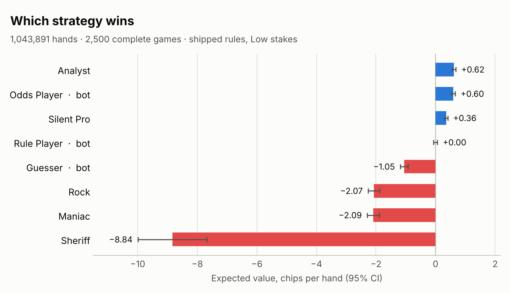

# quartercard

An original card game, designed from scratch, with a complete browser
implementation: bots at four difficulty levels, peer-to-peer multiplayer
lobbies, real accounts, a closed chip economy — and a Monte Carlo simulation
of 3.1 million hands used to tune it.

**The game.** Everyone is dealt two hidden cards and tries to finish closest to
25, taking up to four more cards over two rounds. Each card costs chips — and
the moment anyone takes one, any other player can *call* them, betting they've
gone over. Call right and you take their stake; call wrong and you pay them,
and the hand dies on the spot. Since nobody sees anyone's cards, the only
information at the table is who took cards and how many, and every scrap of it
costs money to produce. The arithmetic is quickly solved; the game is in the
reads.

## Monte Carlo simulation

[`simulation/`](simulation/README.md) is a Python simulator that plays the
game under the shipped rules — its engine is a line-for-line port of
`js/app.js`, cross-checked against the real JavaScript for every possible
2–6 card hand. It measures the **win rate and expected value of eight playing
strategies** over **1,043,891 hands** (2,500 complete games), plus
the value of calling on each card and the best point to stop.

<picture>
  <source media="(prefers-color-scheme: dark)" srcset="simulation/results/strategies-dark.png">
  
</picture>

- **Calling well is worth real money:** the same strategy with and without
  +EV calling differs by +0.26 chips a hand,
  and 56.6% vs 43.9% of games won.
- **Calling badly is the worst mistake in the game:** calling every card loses
  8.84 chips a hand.
- **The penalty is priced as designed:** a call on a player's second card is worth
  −0.06 chips at the shipped penalty of 7 — a judgement call, not a formula.
- **Stand on 23** is the best stopping point.

```bash
cd simulation && python3 simulate.py     # standard library only, ~35s
```

## Chip economy

A closed loop by design: chips enter once — a one-time welcome bonus — are
won and lost only between players at the table, and can **never be cashed
out**. Wallets are an append-only ledger the client can read but never write;
the only ways chips move are three database functions, adversarially tested
against a live Postgres instance. The simulator asserts chip conservation
after every hand: across all 3,081,209 simulated hands, no chip was created or destroyed.
Full design, enforcement, and what is and isn't built yet:
[`docs/ECONOMY.md`](docs/ECONOMY.md).

## Repository

```
index.html            the page
css/styles.css        all styling
js/app.js             the game: engine, bots, lobbies, UI
js/supabase-client.js accounts + wallet  <- the two lines you edit
sql/schema.sql        the chip economy: ledger, security policies, functions
simulation/           Monte Carlo simulator, tests and results
docs/                 design context, history and the economy
legacy/               pre-split single-file version, reference only
```

**New here?** Read [`docs/PROJECT-CONTEXT.md`](docs/PROJECT-CONTEXT.md) first —
the rules, why each tuned number is what it is, and what is deliberately
unfinished. [`docs/DESIGN-HISTORY.md`](docs/DESIGN-HISTORY.md) covers how the
design got here and which changes were tested and rejected.

## Setup

No build step, no npm install. Edit two lines, run one SQL script, upload
the folder.

### 1. Supabase

Create a free project at supabase.com, then:

**Run the schema.** Dashboard → SQL Editor → New query → paste all of
`sql/schema.sql` → Run. This creates the profiles table, the chip ledger,
the security policies, and the three functions that are the only way chips
ever move.

**Copy your keys in.** Dashboard → Project Settings → API. Open
`js/supabase-client.js` and replace the two placeholders:

```js
const SUPABASE_URL = "https://yourproject.supabase.co";
const SUPABASE_ANON_KEY = "eyJhbGci...";
```

The anon key is *meant* to be public — it's safe in client code because
every table it can reach is locked down by the policies in the schema.
Never put the `service_role` key here. That one bypasses all security.

**Decide about email confirmation.** Dashboard → Authentication →
Providers → Email. If "Confirm email" is ON, new players must click a link
before they can play. If OFF, they're in immediately. The app handles both
correctly — it just shows a different message.

### 2. Put it online

Any static host works, since there's no server side. Two easy ones:

- **Netlify Drop** — go to app.netlify.com/drop, drag the whole project
  folder onto the page. Done in about ten seconds.
- **Cloudflare Pages** — free, and lets you add real access control later
  (Cloudflare Access is free for up to 50 users) if you want to keep
  strangers out entirely.

Both give you an `https://` link. A custom domain is £8–12/year and
optional.

Opening `index.html` straight off your hard drive mostly works, but lobby
play won't, and invite links won't be shareable. Use a real link.

### 3. Money model, as built

- New account → one-time welcome bonus, granted by the database, once ever.
  Calling it again returns zero rather than paying twice.
- Chips move between real players through the pot. That funds itself.
- **No cash-out. Ever.** This is the line that keeps it a game rather than
  a licensed gambling operation. Don't add chip transfers between players,
  chip gifting, or any way for a third party to resell chips — that's
  precisely what has put similar apps in legal trouble, even where the
  platform itself never touched real money.
- Full design, enforcement and verification: [`docs/ECONOMY.md`](docs/ECONOMY.md).

### 4. Known limits — read before taking real payments

**The game runs in the browser, not on a server.** The wallet is protected;
the *game* is not. `cash_out` can't verify that the number it's handed
actually happened at a table — it only checks the claim is within a
plausible range and rate-limits attempts. Someone able to forge network
messages could extract more than they won.

That's fine for play money. It is **not** fine once real payments are
involved. Before connecting a payment processor, the game engine needs to
move server-side (Supabase Edge Functions or a small Node service), so the
server deals the cards and reports the result — not the player's phone.

**Wallet-backed play is one signed-in human plus bots.** A wallet belongs
to one account, so pass-the-phone games and invite-link guests (who have no
account at all) stay free practice with throwaway chips. Extending real
stakes to multiplayer means every seat needs its own signed-in account.

**Lobby play needs the host's tab to stay open.** The host's device is the
table. That's the tradeoff for having no game server.
