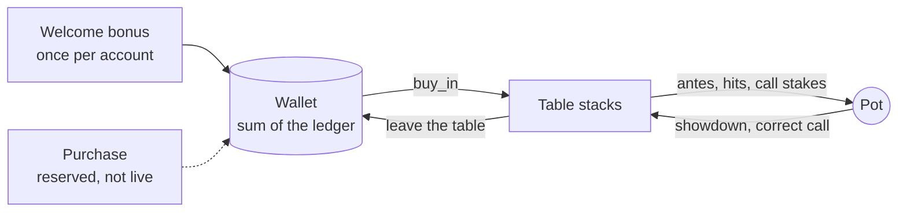

# The chip economy

quartercard runs on chips. This document describes how the economy is designed,
why it is shaped the way it is, how the database enforces it, and how the
simulation verifies it.

**The design in one line:** chips enter the game once, move only between
players at the table, and can never be turned back into money.

---

## 1. Design principles

**A closed loop.** In the finished design, every chip in a player's wallet
traces to one of two sources: the one-time welcome bonus, or a purchase. There is
no third way for a chip to come into existence, and no way at all for one to leave
the game as money. (One gap in the current build is described in §5.)

**Zero-sum between players.** At the table, the pot is funded entirely by the
players' own antes, hit fees and call stakes, and it is paid out entirely to
players. The house takes nothing and adds nothing. One player's win is exactly
another player's loss.

**No cash-out, ever.** This is the line that keeps quartercard a game rather
than gambling. Under the UK Gambling Act 2005, and its equivalents in most
places, what makes something gambling is a prize of money or money's worth.
Chips with no redemption value fall outside that. The moment a chip can be
converted back into cash — officially or through any workaround — the whole
model changes category.

**No transfers, no gifting, no resale.** Apps built on the same "play chips, no
official cash-out" model have been widely criticised because third parties buy
chips from the platform, resell them to players, and settle winnings in cash
off-platform. The platform never touches real money, and it is still the thing
that gets it into trouble. So there is deliberately no way to send chips to
another account. If there is no way to move chips between accounts, there is
nothing to resell.

**One welcome bonus, not a bot payout.** An earlier idea let new players win
real chips from bots for their first 50 games. It was dropped: a new player
would simply grind the weakest bot (the Guesser loses about a chip a hand to
everyone else), and a payout that every new account receives is exactly what
people create throwaway accounts to farm. A small, fixed, one-time bonus gives
new players the same "I won something" moment with nothing to exploit.

---

## 2. How chips move

Chips flow round this loop and nowhere else. A wrong call moves chips directly
from the caller's stack to the accused's; nothing ever leaves the loop as money.

| Step | What happens | Where |
|---|---|---|
| Sign-up | A profile row is created automatically | `handle_new_user` trigger |
| Welcome bonus | 200 chips into the ledger, exactly once per account | `claim_welcome_bonus` |
| Sit down | Chosen buy-in moves from wallet to table; refused if the wallet can't cover it | `buy_in` |
| Play | Chips move between players and the pot, per the game rules | `js/app.js` |
| Leave | Whatever is left of the stack goes back to the wallet | `cash_out` |

A note on naming: the SQL function `cash_out` returns a table stack **to the
wallet**. It does not, and cannot, pay out money — there is no code path from a
chip to a payment anywhere in the system.

---

## 3. How the database enforces it

All of this lives in [`sql/schema.sql`](../sql/schema.sql).

**There is no balance to edit.** A wallet is not a number stored in a table. It
is a view that sums an append-only ledger of every chip movement the account has
ever had. Nothing in the ledger is edited or deleted; a mistake would be reversed
with a new entry, the way a real ledger works. So "where did these chips come
from?" is always answerable from history.

**The client cannot write.** Row Level Security lets a signed-in player *read*
their own profile and their own ledger, and nothing else. There are no insert,
update or delete policies on the ledger at all, so direct writes are refused no
matter who is signed in.

**Three functions are the only doors.** `claim_welcome_bonus`, `buy_in` and
`cash_out` are the only ways a ledger row is ever written. Each does exactly one
thing:

- **Welcome bonus — exactly once.** The function locks the player's profile row,
  checks a flag, sets it, and writes the entry. A second call returns 0 rather
  than paying again, and two simultaneous clicks cannot both get through.
- **Buy-in — never overdraws.** The balance check and the debit happen under the
  same lock, so two rapid buy-ins cannot both read the same balance and both
  succeed.
- **Leaving a table — bounded.** Because the game itself runs in the browser (see
  §5), the database cannot independently confirm a reported stack. So the amount
  returned is bounded: at most 50× what the account bought in over a rolling
  24-hour window, scoped to the account rather than to anything the client
  chooses, and limited to 20 buy-in/leave calls in 10 minutes.

**No anonymous access.** Postgres lets anyone execute a new function by default.
That grant is explicitly revoked, so only signed-in players can call these
functions at all.

### Tested by attacking it

The schema was run against a real local Postgres instance and attacked as two
simulated users trying to cheat, rather than read through. 13 adversarial checks
pass on a fresh database. That process found and fixed three real bugs before
they shipped:

1. **Unlimited minting.** `cash_out` originally had no bound — any signed-in user
   could call it with any number and create a million chips in one request.
2. **The bypass of the first fix.** The bound was scoped to a table reference the
   client supplied, so inventing a new reference reset it. It is now scoped to the
   account.
3. **Death by a thousand cuts.** A ratio bound limits size, not frequency, so many
   small calls could still add up. Closed with a rate limit.

---

## 4. How the simulation verifies it

The Monte Carlo simulator ([`simulation/`](../simulation/README.md)) plays the
game under the shipped rules and treats the economy's core claim as an invariant:

- **After every hand**, the total of every player's chips plus the pot must equal
  the chips the table started with. The simulator asserts this and would stop
  the moment it failed.
- **After every game**, every player's net result must sum to exactly zero.

Both held across all **3,081,209 simulated hands**. No chip was created or
destroyed; every chip one player won, another player lost.

The simulation also stress-tested the economy's incentives:

- **The penalty is priced so calling is a read, not a formula.** A call on a
  player's second card — where about a third of all calling decisions happen —
  is worth −0.06 chips at the shipped penalty of 7. A penalty of 5 would make it
  profitable to call on sight; a penalty of 10 would kill calling.
- **Reckless calling is expensive.** A player who calls every card loses 8.84
  chips a hand, by far the worst result of any strategy.
- **An edge case worth knowing.** Each wrong call kills the hand and the pot
  carries over, so a player with a very deep stack who calls every card can keep
  a table from ever reaching a showdown — with unlimited chips, only 6% of hands
  did. What stops this in practice is the stack: at the default 200 chips a
  wrong call costs 12, so that player is out after about 16 of them. If large
  table stacks ever become common — big buy-ins in wallet play, say — a cap on
  table stacks or on calls per hand would be worth adding.

---

## 5. Status and honest limits

**Built and verified:** the ledger, the three chip functions, the security
policies, the welcome bonus, wallet-backed buy-in and return wired into the game,
and — by simulation — chip conservation under the game's rules.

**Wallet play is currently one signed-in player against bots — and that is the
one place the build departs from the design.** Pass-the-phone games share a screen
between several people and invite-link guests have no account, so the only
wallet-backed table built so far is one player against bots. Chips won from those
bots go back into the player's wallet, bounded by the 50× limit. Since bot stacks
are not funded by anyone, that makes bot wins a second source of chips — the bot
payout the design deliberately rejected, re-entering through the only wallet mode
that exists. The fix is the step that completes the player-versus-player loop:
make multiplayer tables wallet-backed (every seat signed in), and turn bot games
into free practice that never touches a wallet.

**The wallet is protected; the game is not.** The game engine runs in the
player's browser, so the database can bound a reported stack but cannot confirm
it happened. That is fine for play chips. Before purchases go live, the game
engine should move server-side so the server deals the cards and reports the
result — which would also remove the need for the leave-table bound entirely.

**Purchases are reserved, not live.** The ledger already accepts a `purchase`
entry type so payments can slot in later, but no code writes one yet, for the
reason above.
