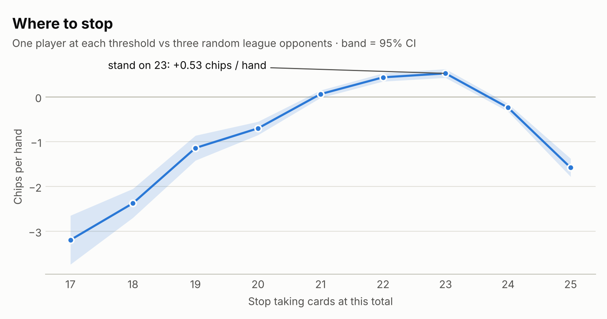

# Monte Carlo simulation

A Python simulation of **3,081,209 hands** of quartercard, built to answer
three questions about the game's design with numbers rather than intuition:

1. **Which playing strategies win, and by how much?** — win rate and expected value
   for eight strategies over **1,043,891 hands** (2,500 complete games).
2. **Is the wrong-call penalty set right?** — the value of calling on each card, at
   three candidate penalties.
3. **Where should a player stop taking cards?**

It plays the game exactly as shipped: the rules engine is a line-for-line port of
`js/app.js`, and a test checks the card arithmetic against the real JavaScript for
every possible 2–6 card hand.

<picture>
  <source media="(prefers-color-scheme: dark)" srcset="results/strategies-dark.png">
  
</picture>

## Run it

```bash
cd simulation
python3 simulate.py            # full run, ~3.1M hands, ~35s on 2 cores
python3 simulate.py --quick    # smoke test
python3 -m unittest -v         # 12 tests, including the cross-check against js/app.js
python3 plot_results.py        # redraw the charts (needs matplotlib)
```

Standard library only — no installs needed to simulate. Every game is seeded
individually (`--seed`, default `2026`), so a run reproduces exactly, whatever
the number of worker processes. Full output: [`results/results.md`](results/results.md)
and [`results/results.json`](results/results.json).

## Results

### Strategy league — 1,043,891 hands

Eight strategies are dealt into random four-seat tables. Every table plays a
complete game at Low stakes — 200-chip stacks, ante 10, hit 2, call 5, penalty 7 —
until one player has every chip.

| Rank | Strategy | Type | EV, chips / hand | Win rate | Call accuracy |
|---|---|---|---|---|---|
| 1 | **Analyst** | archetype | +0.62 ± 0.06 | 56.6% | 54.6% |
| 2 | **Odds Player** | in-game bot | +0.60 ± 0.06 | 55.7% | 54.3% |
| 3 | **Silent Pro** | archetype | +0.36 ± 0.06 | 43.9% | — |
| 4 | **Rule Player** | in-game bot | +0.00 ± 0.06 | 25.0% | 51.7% |
| 5 | **Guesser** | in-game bot | −1.05 ± 0.13 | 8.1% | 34.2% |
| 6 | **Rock** | archetype | −2.07 ± 0.19 | 3.0% | — |
| 7 | **Maniac** | archetype | −2.09 ± 0.20 | 3.1% | 36.4% |
| 8 | **Sheriff** | archetype | −8.84 ± 1.16 | 5.1% | 13.4% |

**EV** is chips won per hand played; ± is a 95% confidence interval. **Win rate** is
the share of games won outright — 25% is break-even at four seats.

| Strategy | How it plays |
|---|---|
| Analyst | Stands on 23, calls only when calling is +EV (calibrated odds) |
| Odds Player | In-game Hard bot: stands on 22, calls when its static odds table says EV > 0 |
| Silent Pro | Stands on 23 (the measured optimum), never calls |
| Rule Player | In-game Medium bot: stands on 21, calls from the 3rd card |
| Guesser | In-game Easy bot: random nerve 19-24 each hand, uncalibrated suspicion |
| Rock | Stands on 19, never calls — plays not to lose |
| Maniac | Pushes all the way to 25, calls anyone on their 2nd card or later |
| Sheriff | Stands on 22, calls every single card anyone takes |

### What the league shows

**Calling well is worth real money.** Analyst and Silent Pro stop at the same total;
the only difference is that Analyst calls when calling is +EV. That alone is worth
**+0.26 chips a hand** and lifts the win rate from
43.9% to 56.6%. The call mechanic is the game's identity,
and this is the measurement that says it matters.

**Calling badly is the most expensive mistake in the game.** The Sheriff calls every
card, is right 13.4% of the time, and loses 8.84
chips a hand — four times worse than anything else.

**Both extremes lose the same amount.** The Rock (stops at 19) and the Maniac (pushes
to 25) finish within 0.02 chips a hand of each other, from opposite directions.

**The in-game difficulty ladder holds.** Hard (+0.60) beats
Medium (+0.00) beats Easy (−1.05),
each gap well outside the confidence intervals.

### Is the penalty right? — the value of a call, card by card

When the call window opens on a player's k-th card, how often are they really over 25,
and what is a call worth?

| Card | Share of call windows | Actually over 25 | EV, penalty 5 | **EV, penalty 7 (shipped)** | EV, penalty 10 |
|---|---|---|---|---|---|
| 1 | 60.9% | 14.2% | −6.17 | **−7.89** | −10.46 |
| 2 | 31.2% | 38.5% | +1.17 | **−0.06** | −1.90 |
| 3 | 7.5% | 55.5% | +7.20 | **+6.31** | +4.98 |
| 4 | 0.3% | 67.3% | +12.22 | **+11.56** | +10.58 |

The design target was for a call on the **second card** — where 31.2% of the
action is — to sit between −1 and 0: slightly unprofitable, so calling stays a read
rather than a formula. At penalty 7 it lands at **−0.06** (callers in the league
actually realised −0.39 per call). Penalty 5 would make it
+1.17 — positive, so the maths would say *always call* and the bluff
disappears. Penalty 10 pushes it to −1.90, where nobody sensible calls at all.

### Where to stop

<picture>
  <source media="(prefers-color-scheme: dark)" srcset="results/threshold-dark.png">
  
</picture>

Standing on **23** is the best measured stopping point (+0.53 chips a hand),
with 22 close behind (+0.44 — inside the noise). Standing on 21 is break-even;
19 and below bleed chips; pushing to 24 or 25 overshoots.

### Shape of the game

- 84.0% of hands reach a showdown; 16.0% are killed by a
  wrong call and the pot carries over.
- 15.9% of showdowns split the pot, and 44.5% of those
  are mirror ties such as 24 v 26.
- A full game from a 200-chip start lasts 418 hands on average.
- **Chip conservation is asserted after every hand, and every game is checked to be
  exactly zero-sum** — across all 3,081,209 hands, no chip was ever created or
  destroyed. Chips only move between players. See [`../docs/ECONOMY.md`](../docs/ECONOMY.md).

## How it works

```
engine.py        the rules, ported line for line from js/app.js
strategies.py    the eight strategies (three are the in-game bots, ported exactly)
simulate.py      the experiments, statistics and report
test_engine.py   12 tests: card maths, scripted hands, and a cross-check against js/app.js
plot_results.py  the charts above
```

**Faithful rules.** Aces read as whichever total sits closest to 25; a hand is bust
only if its lowest reading is over 25; two cards are dealt before the ante; two rounds
of turns; four cards maximum; a call window after every card; joint calls split one
call's worth rather than multiplying it; a wrong call kills the hand and carries the
pot; equal distance from 25 splits the pot. `test_engine.py` checks the card arithmetic
against the real `js/app.js` for all 26,936 possible 2–6 card hands — and fails if the
JavaScript's rules are changed.

**Complete games, not isolated hands.** An early version gave every player unlimited
chips. It found a real edge case: a player who calls every card can stall a table
indefinitely, because each wrong call kills the hand and the pot just keeps carrying —
with that player at the table and unlimited chips, only 6% of hands ever reached a showdown. In the real game that is
self-limiting, because the caller runs out of chips, so every simulated game uses real
starting stacks and elimination.

**Calibrated calling.** The Analyst does not guess its odds. A 100,000-hand calibration
pass first measures how often players in this field are really over 25 at each call
window; the Analyst then calls only when that probability makes the call +EV.

**Honest error bars.** Hands within one game are not independent — chips and carried pots
link them — so confidence intervals use batch means over whole games, which are.

**Reproducible.** Each game draws its own random stream from a string seed
(`"<seed>:<experiment>:<game>"`), so results are identical on any machine and any number
of cores.

## Limitations

- **The simulated players never bluff.** Real players take cards while safe to bait a
  call, which makes them look riskier than they are, lowers the true bust rate at a call
  window, and makes calling slightly worse than measured here.
- **The Card Counter (Expert bot) is not in the league.** It runs a nested Monte Carlo of
  ~900 samples per decision, roughly a thousand times the cost of the others. Its ranking
  against the other bots was measured separately in the browser engine — see
  [`../docs/DESIGN-HISTORY.md`](../docs/DESIGN-HISTORY.md).
- **Results depend on the field.** Bust rates at a call window come from how *these*
  strategies take cards; a different population of players would shift them.
